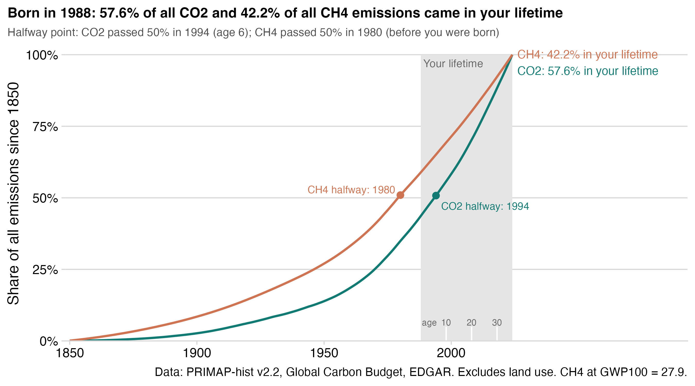
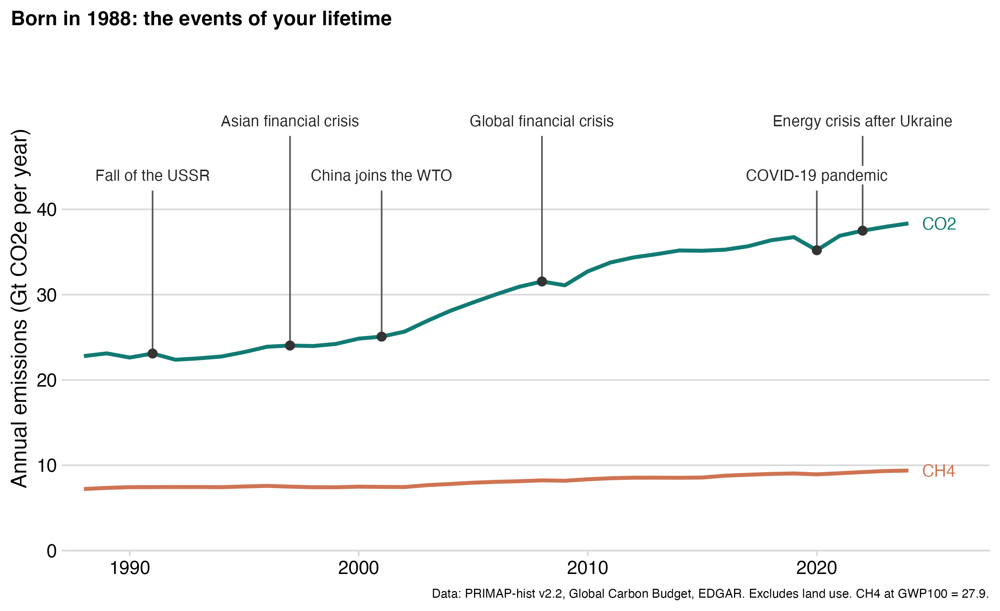
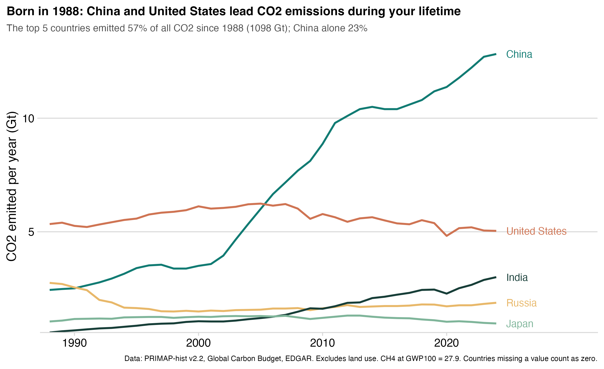
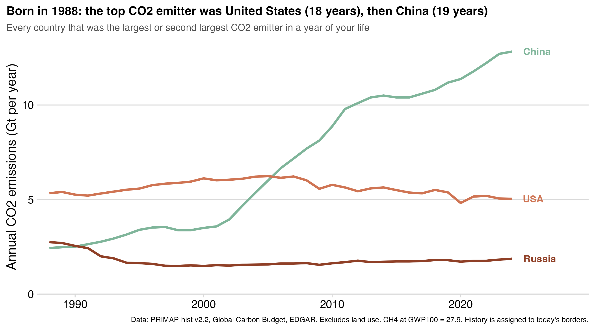
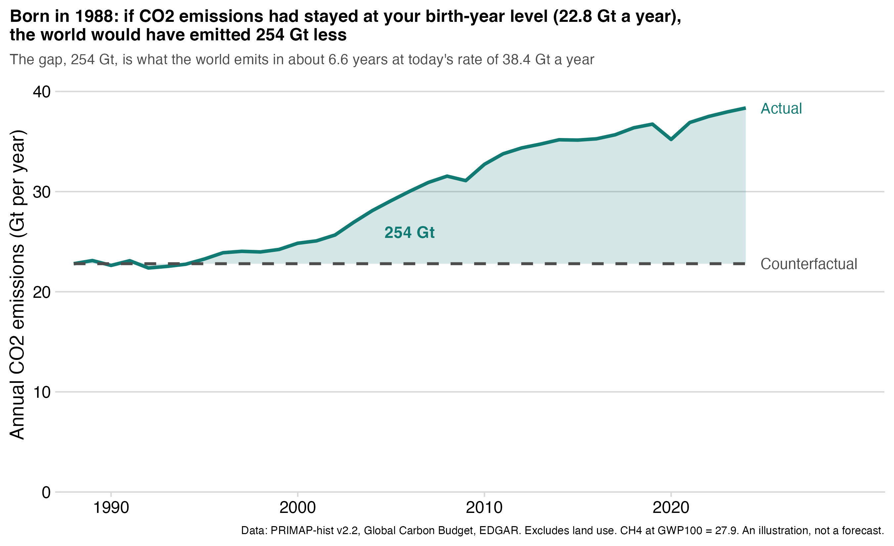
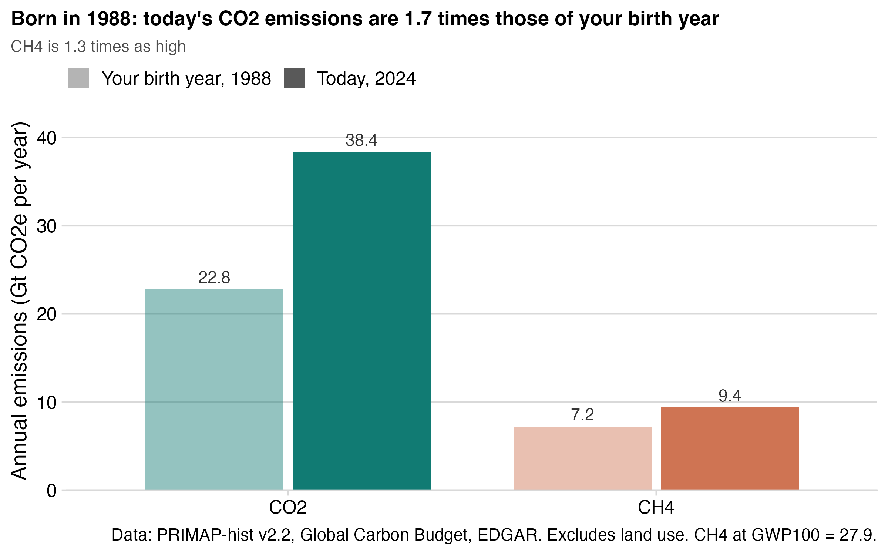
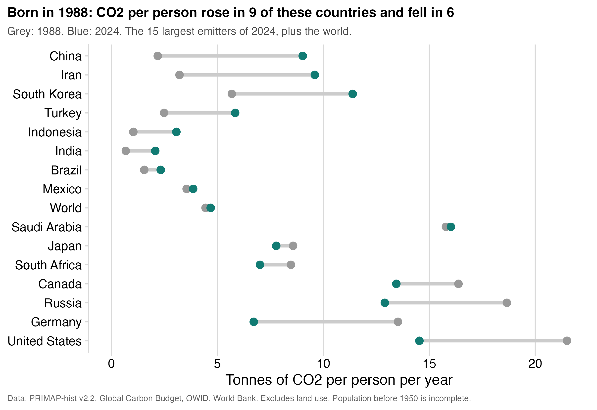
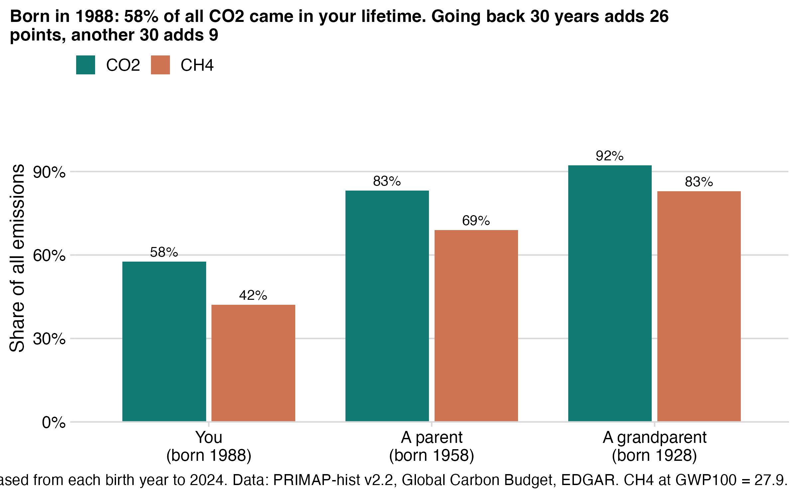

```{r}
#| include: false
# Small tables for the live numbers in the text. Charts load their own data (charts/d_scrollytelling/*.html).
library(readr)
world <- read_csv("../data/emissions_global_year.csv", show_col_types = FALSE)[, c("year", "co2_mt", "ch4_mtco2e")]
names(world) <- c("year", "co2", "ch4")
ev <- read_csv("../data/events_impact.csv", show_col_types = FALSE)
ev <- unique(ev[ev$kind == "event", c("event", "start", "description")])
lead <- read_csv("../data/top_emitter_by_year.csv", show_col_types = FALSE)
lead <- lead[lead$gas == "co2", c("year", "country")]
gens <- read_csv("../data/generations.csv", show_col_types = FALSE)
ojs_define(world = world, ev = ev, lead = lead, gens = gens)
```

```{=html}
<style>
  .birth-box { position: sticky; top: 10px; width: fit-content; margin: 0.5rem auto 1.2rem; z-index: 1000; background: #fff; border: 2px solid #117B73; border-radius: 12px;
               padding: 6px 12px; box-shadow: 0 4px 14px rgba(23, 62, 56, 0.18); font-family: 'Inter', sans-serif; }
  .birth-box label { font-weight: 700; color: #173E38; margin-right: 8px; }
  .birth-box input { width: 80px; font-size: 16px; font-weight: 700; color: #173E38; }
  .chart-frame { width: 100%; height: 78vh; border: 0; background: #fff; border-radius: 14px; box-shadow: 0 4px 18px rgba(23, 62, 56, 0.10); }
  .cr-section .sticky-col .sticky-col-stack .sticky { width: 100%; pointer-events: none; }
  .cr-section .sticky-col .sticky-col-stack .sticky.cr-active { pointer-events: auto; }
  .method { max-width: 780px; margin: 3rem auto; padding: 0 1rem; font-size: 1.05rem; }

  /* ---- scrollytelling polish ---- */
  :root { --forest:#173E38; --teal:#117B73; --sage:#A9C9B8; --ivory:#F7F8F3; --terra:#CF7453; --sand:#E8B86A; }
  .cr-section .sticky-col .sticky-col-stack { height: 100dvh; }
  /* tighter scroll distance: each step is ~ one screen, not two */
  .cr-section .narrative-col .trigger { padding-block: 14svh; padding-inline: 20px; }
  .cr-section .narrative-col .trigger .narrative { padding: 0; line-height: 1.6; max-width: 34em; }
  .cr-section .narrative-col .trigger .narrative > p { margin-bottom: 0.9em; }
  .cr-section .narrative-col .trigger .narrative > p:last-child { margin-bottom: 0; }
  /* closeread makes each heading its own trigger; pull heading and its text together as one block */
  .cr-section .narrative-col section.level2.trigger { padding-block: 16svh 0; padding-bottom: 0; }
  .cr-section .narrative-col section.level2.trigger + .trigger { padding-top: 0.6rem; }
  .cr-section .narrative-col section.level2.trigger + .trigger .narrative { padding-top: 0; }
  .cr-section .narrative-col section.level2.trigger h2.narrative { font-size: clamp(2rem, 3.4vw, 3rem); font-weight: 800; line-height: 1.05; letter-spacing: -0.025em;
      color: var(--forest); margin: 0 0 0.35em; padding: 0 0 0.45em; border: 0; max-width: 11em; }
  .cr-section .narrative-col section.level2.trigger h2.narrative::after { width: 72px; height: 5px; bottom: 0; }
  .cr-section .narrative-col .trigger .narrative p { font-size: 1.12rem; color: #304B47; }
  .cr-section .narrative-col .trigger .narrative strong { color: var(--forest); }
  /* one continuous stage: charts cross-fade with a gentle zoom; the outgoing chart recedes, the incoming one settles in */
  .cr-section .sticky-col .sticky-col-stack .sticky { width: 100%; padding: 2.5vh 2vw; box-sizing: border-box;
      transform: scale(0.965); transition: opacity 0.7s cubic-bezier(.4,0,.2,1), transform 0.9s cubic-bezier(.22,.8,.3,1); will-change: opacity, transform; }
  .cr-section .sticky-col .sticky-col-stack .sticky.cr-active { transform: scale(1); }
  .chart-frame { height: 84vh; }
  /* opening overview: all eight charts as a contact sheet */
  .overview { display: grid; grid-template-columns: repeat(4, 1fr); gap: 14px; width: 100%; }
  .overview figure { margin: 0; background: #fff; border-radius: 12px; overflow: hidden; box-shadow: 0 4px 18px rgba(23,62,56,0.12); border-bottom: 4px solid var(--teal); }
  .overview figure:nth-child(3n) { border-bottom-color: var(--terra); }
  .overview figure:nth-child(4n) { border-bottom-color: var(--sand); }
  .overview img { display: block; width: 100%; aspect-ratio: 16/10; object-fit: cover; object-position: top; }
  .overview figcaption { font: 600 0.8rem 'Inter', sans-serif; color: var(--forest); padding: 6px 10px 7px; }
  .overview-note { text-align: center; font: 600 0.9rem 'Inter', sans-serif; color: var(--teal); margin-top: 12px; }
  .intro-text { max-width: 44rem; margin: 0 auto 0.6rem; text-align: center; font-size: 1.15rem; }
  .method { margin-top: 2rem; }
  .method h2 { font-size: 2rem; font-weight: 800; color: var(--forest); letter-spacing: -0.02em; }
  @media (max-width: 991px) { .overview { grid-template-columns: repeat(2, 1fr); gap: 8px; } .overview figcaption { font-size: 0.7rem; } }
  @media (max-width: 575.98px) {
    .cr-section .narrative-col .trigger { padding-block: 40svh 6svh; }
    .cr-section .narrative-col section.level2.trigger { padding-block: 40svh 0; }
    .cr-section .narrative-col section.level2.trigger + .trigger { padding-block: 0.6rem 6svh; }
    .cr-section .narrative-col .trigger .narrative { background: #173E38ee; color: #F7F8F3; padding: 0.8em 1em; border-radius: 10px; }
    .cr-section .narrative-col .trigger .narrative p, .cr-section .narrative-col .trigger .narrative strong { color: #F7F8F3; }
    .cr-section .narrative-col .trigger .narrative h2 { font-size: 1.6rem; border-top-color: #E8B86A; }
    .chart-frame { height: 62vh; }
  }
  @media (prefers-reduced-motion: reduce) {
    .cr-section .sticky-col .sticky-col-stack .sticky { transition: opacity 0.01s; transform: none !important; }
  }
</style>
<script>
  // Charts 1 and 2 let the visitor click a year on the chart; the chart tells this page, which updates the birth year box.
  window.addEventListener('message', function(ev) {
    if (!ev.data || !ev.data.birth) return;
    var box = document.querySelector('.birth-box input[type=number]');
    if (box) { box.value = ev.data.birth; box.dispatchEvent(new Event('input', {bubbles: true})); }
  });
  // Show the overview as soon as the story stage appears, before the first trigger has fired.
  window.addEventListener('load', function() {
    var ov = document.getElementById('cr-overview');
    if (ov && !document.querySelector('.sticky.cr-active')) ov.classList.add('cr-active');
  });
</script>
```

::: {.birth-box}
```{ojs}
viewof birthInput = Inputs.number([1850, 2024], {value: 1988, step: 1, label: "Birth year"})
```
:::

```{ojs}
// Everything below reads this one birth year, kept inside the data range
birth = Math.min(2024, Math.max(1850, Math.round(birthInput || 1988)))
w = transpose(world)
events = transpose(ev)
leaders = transpose(lead)
generations = transpose(gens)
last = 2024
sum = (rows, key, from) => d3.sum(rows.filter(r => r.year >= from), r => r[key])
pct = x => (100 * x).toFixed(1) + "%"
lifeShare = ({co2: sum(w, "co2", birth) / sum(w, "co2", 0), ch4: sum(w, "ch4", birth) / sum(w, "ch4", 0)})
halfYear = key => { let run = 0, total = sum(w, key, 0); for (const r of w) { run += r[key]; if (run >= total / 2) return r.year; } }
half = ({co2: halfYear("co2"), ch4: halfYear("ch4")})
agePhrase = year => year < birth ? "before you were born" : year === birth ? "the year you were born" : `when you were ${year - birth}`
generation = { const g = generations.find(g => g.start_birth_year <= birth && birth <= g.end_birth_year); return g ? g.generation : (birth < 1928 ? "before the Silent generation" : "Gen Alpha or later"); }
sliderRate = Generators.observe(notify => { const f = e => { if (e.data && e.data.rate !== undefined) notify(e.data.rate); }; notify(0); window.addEventListener('message', f); return () => window.removeEventListener('message', f); })
buildStamp = Date.now()
frame = name => html`<iframe class="chart-frame" src="../charts/d_scrollytelling/${name}.html?embed=1&birth=${birth}&v=${buildStamp}"></iframe>`
```

::: {.intro-text}
Type the year you were born in the box above. It stays at the top as you scroll, and every chart below redraws for your lifetime.
:::

```{ojs}
md`You were born in **${birth}**, which makes you part of **${generation}**. Scroll down.`
```

::::::: {.cr-section layout="sidebar-left"}

## The whole story at a glance

Eight charts, one story, told for your lifetime. Keep scrolling and each chart takes the stage in turn. @cr-overview


## The whole record

We have yearly global emissions of carbon dioxide (CO2) and methane (CH4) back to 1850. The lines show how much of everything emitted since 1850 had been released by each year. The shaded band is your lifetime. @cr-share

```{ojs}
md`**${pct(lifeShare.co2)}** of all CO2 and **${pct(lifeShare.ch4)}** of all CH4 recorded since 1850 was released while you have been alive. Half of all CO2 had been emitted by **${half.co2}** (${agePhrase(half.co2)}), half of all CH4 by **${half.ch4}** (${agePhrase(half.ch4)}).`
```

The steep part of the curve is recent. Dots mark the halfway years, and the ticks inside your band are your ages. Click the chart to try another birth year.

## What the world was going through

Emissions are not a smooth climb. Wars, recessions, oil shocks and the pandemic bent the curve. Each line on the chart marks the year an event began. @cr-events

```{ojs}
measured = events.filter(e => e.start > birth).sort((a, b) => a.start - b.start)
md`${measured.length === 0 ? "None of the events in our list fall inside your lifetime." : `**${measured.length}** events in our list happened during your lifetime:` + String.fromCharCode(10, 10) + measured.map(e => `- **${e.start}: ${e.event}.** ${e.description}`).join(String.fromCharCode(10))}`
```

Hover a year on the chart for the emissions numbers behind it.

## Who emitted it

Which countries emitted the most during your lifetime? The five biggest appear first. The list on the left ranks every country, and a click on a name shows or hides its line, so you can add your own country or clear the chart. @cr-countries

Then switch **Measure** to *Emissions per person*. The ranking changes completely: the countries that emit the most in total are not the ones that emit the most per resident. The choice of measure changes the story.

## Who led, and by how much

Which country emitted the most CO2 in each year of your life, and how close was the next one? Each line is one country's yearly emissions, and its name sits at the right end of the line. The countries shown are the ones that were the largest or second largest emitter in at least one year of your life. @cr-leaders

```{ojs}
runs = { const out = []; for (const r of leaders.filter(r => r.year >= birth).sort((a, b) => a.year - b.year)) { const l = out[out.length - 1]; if (l && l.country === r.country) l.years++; else out.push({country: r.country, years: 1}); } return out; }
md`The largest CO2 emitter of your lifetime was ${runs.map(r => `**${r.country}** (${r.years} ${r.years === 1 ? "year" : "years"})`).join(", then ")}.`
```

**How to read it.** The higher a line, the more that country emitted in that year. Where one line crosses another, the lead changed hands. The space between two lines is the gap: a wide gap means the leader was far ahead, and lines that run close together mean a tight race. Hover a year to see every country's number.

**Why it matters.** A ranking only tells you who is first. The lines also show how big the lead was and how quickly it moved, which a list of names cannot. They show that the leader is not fixed: China overtook the United States in 2006, so anyone born before then has seen the lead change hands. Where the lines are heading is where most of today's emissions come from, and that is where changes in emissions now have the largest effect.

Past states are assigned to today's borders, so the Soviet Union appears as Russia.

## What if emissions had stopped growing?

So far we have described what happened. Now a thought experiment: hold emissions at the level of your birth year, and compare. The shaded gap is how much more the world emitted than it would have. @cr-whatif

```{ojs}
flat = w.filter(r => r.year >= birth)
gapGt = rate => d3.sum(flat, r => r.co2 - flat[0].co2 * Math.pow(1 + rate / 100, r.year - birth)) / 1000
nowGt = flat[flat.length - 1].co2 / 1000
path = rate => rate === 0 ? `stayed at its ${birth} level` : `${rate < 0 ? "fallen" : "grown"} ${Math.abs(rate)}% a year from ${birth}`
md`If CO2 had ${path(sliderRate)}, the world would have emitted **${Math.round(Math.abs(gapGt(sliderRate)))} Gt** ${gapGt(sliderRate) >= 0 ? "less" : "more"} CO2 during your lifetime.`
```

```{ojs}
md`**What does that mean in everyday terms?** Right now the world emits about **${nowGt.toFixed(0)} Gt** of CO2 every year. A gap of ${Math.round(Math.abs(gapGt(sliderRate)))} Gt is the amount the world emits in about **${(Math.abs(gapGt(sliderRate)) / nowGt).toFixed(1)} years** at today's rate. It is only a way to feel how big the number is.`
```

Use the slider to test other paths, from emissions falling 5% a year to rising 3%; the numbers above follow it. This is an illustration of scale, not a forecast: real emissions move with population and the economy.

## Then and now

How does today compare with the year you were born? @cr-thennow

```{ojs}
atBirth = w.find(r => r.year === birth)
today = w.find(r => r.year === last)
md`Emissions of CO2 are **${(today.co2 / atBirth.co2).toFixed(1)} times** what they were in the year you were born, and methane **${(today.ch4 / atBirth.ch4).toFixed(1)} times**.`
```

## Per person, then and now

Totals hide how many people share them. Here is CO2 per person in the year you were born and in 2024, for the 15 biggest emitters of 2024 and the world. A grey dot is your birth year, a blue dot is 2024, and the line between them is the change. Countries at the top grew the most per person; those at the bottom cut the most. @cr-perperson

Hover a row for the numbers.

## Your family's ladder

Now step back through your family: a parent born 30 years before you, a grandparent 60 years before. @cr-ladder

```{ojs}
shareFrom = (key, y) => sum(w, key, Math.max(1850, y)) / sum(w, key, 0)
s0 = shareFrom("co2", birth)
s1 = shareFrom("co2", birth - 30)
s2 = shareFrom("co2", birth - 60)
md`Go back one generation, 30 years before you were born: the share of CO2 rises from ${pct(s0)} to **${pct(s1)}**. Two generations back, it is **${pct(s2)}**. Most of the story is recent.`
```

::: {#cr-overview}
<div class="overview">
<figure><figcaption>1 · The whole record</figcaption></figure>
<figure><figcaption>2 · What the world was going through</figcaption></figure>
<figure><figcaption>3 · Who emitted it</figcaption></figure>
<figure><figcaption>4 · Who led, and by how much</figcaption></figure>
<figure><figcaption>5 · What if emissions had stopped growing?</figcaption></figure>
<figure><figcaption>6 · Then and now</figcaption></figure>
<figure><figcaption>7 · Per person, then and now</figcaption></figure>
<figure><figcaption>8 · Your family's ladder</figcaption></figure>
</div>
:::

::: {#cr-share}
```{ojs}
frame("01_lifetime_share")
```
:::

::: {#cr-events}
```{ojs}
frame("02_events_impact")
```
:::

::: {#cr-countries}
```{ojs}
frame("03_countries_lifetime")
```
:::

::: {#cr-leaders}
```{ojs}
frame("04_leaders_lifetime")
```
:::

::: {#cr-whatif}
```{ojs}
frame("05_counterfactual")
```
:::

::: {#cr-thennow}
```{ojs}
frame("06_year_vs_today")
```
:::

::: {#cr-perperson}
```{ojs}
frame("08_per_person_then_now")
```
:::

::: {#cr-ladder}
```{ojs}
frame("07_generational_ladder")
```
:::

:::::::

::: {.method}
## How this was made, and what to be careful about

- **Data.** Annual CO2 and CH4 emissions by country, 1850 to 2024, excluding land use: PRIMAP-hist v2.2 (to 2018), Global Carbon Budget and EDGAR (later years). CH4 is converted to CO2 equivalent at GWP100 = 27.9. World totals are the sum of countries.
- **Borders.** History is assigned to today's borders, so emissions of the Soviet Union appear under Russia and its other successor states.
- **Events.** Each event is marked in the year it began (China joins the WTO in 2001, the global financial crisis in 2008). The chart shows when things happened; it does not claim an event caused any change in the curve. Policy milestones such as Kyoto and Paris are not marked.
- **Per person.** The default per person ranking leaves out countries with under one million people, which would otherwise top any list. You can add any country yourself. Kuwait's 1991 spike is the Gulf War oil-well fires.
- **The thought experiment** is a simple calculation, not a model of what was possible.
- **Gaps.** A few small territories lack some years; countries missing a value count as zero in the totals.
:::
